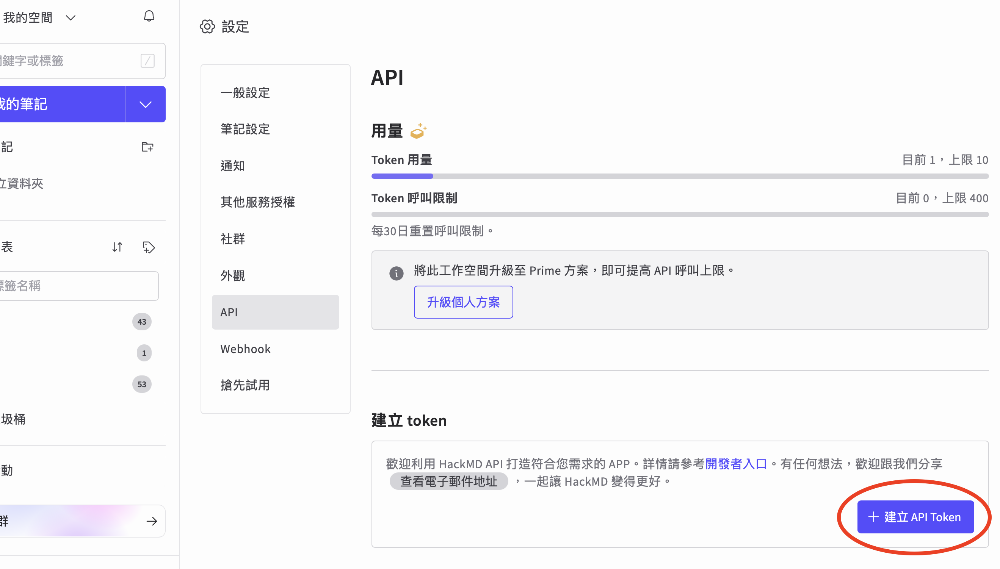
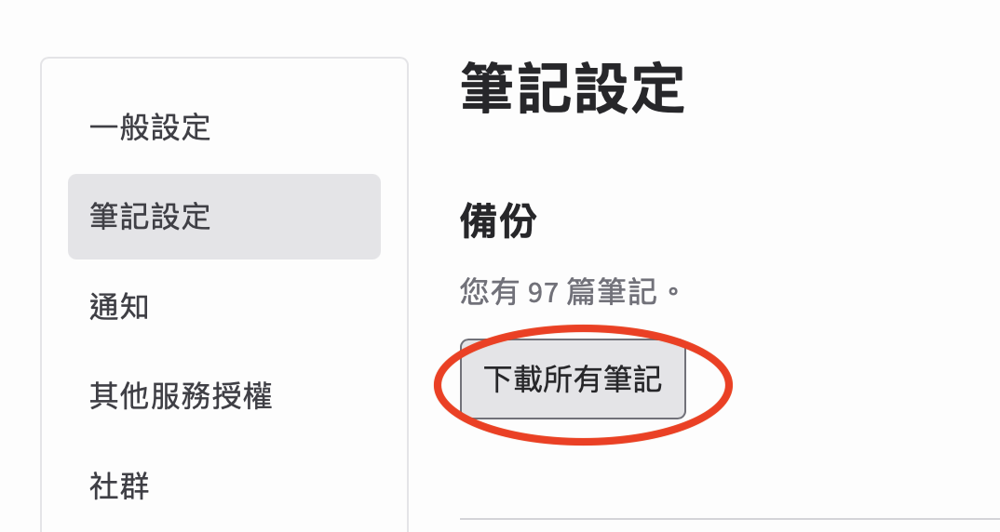

# HackMD 備份圖片下載工具

將 HackMD 筆記單向備份到本機，接著自動下載 Markdown 內的圖片、改成本機連結，並依第一個 tag 整理筆記。程式會記錄已備份的筆記，只有內容更新時才再次備份。

- 不會新增、修改或刪除 HackMD 上的筆記。
- 只需要 Python 3，不必安裝第三方套件。
- 支援公開及 private 筆記與圖片。
- 預設不產生 `.bak` 檔。

## 1. 設定 HackMD token

HackMD token 取得方法：



在程式所在目錄建立 `.env`：

```dotenv
HACKMD_TOKEN=你的token
```

`.env` 應列入 `.gitignore`，不要分享或提交這個檔案。

## 2. 執行備份

推薦直接執行：

```bash
python3 backup_hackmd.py
```

程式會依序：

1. 從 HackMD 增量備份筆記。
2. 依第一個 tag 整理 Markdown。
3. 下載遠端圖片並改成本機相對路徑。
4. 修正程式碼區塊的語言標記，例如將 `cpp=` 改成 `cpp`。

只預覽、不寫入檔案：

```bash
python3 backup_hackmd.py --dry-run
```

只備份筆記，不執行圖片下載程式：

```bash
python3 backup_hackmd.py --no-images
```

> `--dry-run` 仍需要呼叫 HackMD API，因此仍會使用少量 API 額度。

## 輸出位置

備份會放在 `raw_hackmd/`：

```text
raw_hackmd/
├── personal/
│   ├── Coding/
│   │   └── 筆記名稱--shortId.md
│   └── image/
│       └── 筆記名稱--shortId/
├── teams/
│   └── 團隊名稱/
└── .hackmd-backup.json
```

- 有 tag：Markdown 放在第一個 tag 的資料夾。
- 沒有 tag：Markdown 留在 `personal/` 或所屬 team 的根目錄。
- 圖片放在同一組筆記旁的 `image/文件名稱/`。
- 圖片已存在時會直接沿用，不會重複下載。
- `.hackmd-backup.json` 是增量備份狀態，請勿手動修改或刪除。

## API 使用方式

- 每次先呼叫一次筆記清單 API。
- 只有新增、變更或上次失敗的筆記，才另外抓取完整內容。
- 沒有任何筆記異動時，備份部分通常只使用 1 次 API 呼叫。
- 圖片會先嘗試匿名下載；匿名失敗且網址屬於 HackMD 時，才使用 token。
- 若圖片下載失敗，畫面會列出網址、錯誤原因及引用它的 Markdown 檔案。

## 單獨處理既有 Markdown

如果已有從 HackMD 匯出的資料夾，也可以只執行圖片下載程式：
先從 HackMD 下載筆記：


```bash
python3 download_markdown_images.py HackMD_User_資料夾 --env-file ../.env
```

先預覽：

```bash
python3 download_markdown_images.py HackMD_User_資料夾 --env-file ../.env --dry-run
```

不要依 tag 搬移 Markdown：

```bash
python3 download_markdown_images.py HackMD_User_資料夾 --env-file ../.env --no-organize
```

需要在修改前建立 `.bak` 時：

```bash
python3 download_markdown_images.py HackMD_User_資料夾 --env-file ../.env --backup
```

## 注意事項

- 這是單向備份，HackMD 永遠是來源端，本機內容不會上傳回 HackMD。
- 如果備份階段失敗，程式會略過圖片處理；下次執行會自動重試。
- 不要公開 `.env` 或畫面中的 token；如果不慎外洩，請立即到 HackMD 撤銷並重新產生。
- 第一次備份需要逐篇下載，API 呼叫較多；後續增量備份通常只會檢查清單與有變更的筆記。
